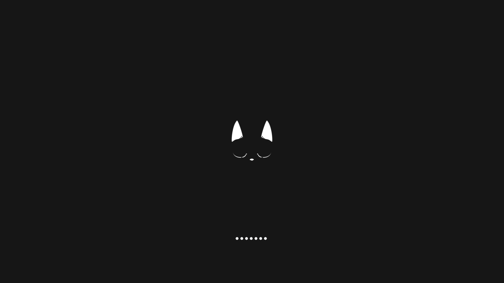

# Kuro — Plymouth theme



A black cat that wakes up while your machine does. This is a port of the KDE splash
screen [kuro](https://github.com/KartikSindura/kuro) by kartik, moved from the Plasma splash into the boot process, so the cat already greets you
before there's a desktop to look at.

KDE splash screens only run *after* login, so they can't do this. Plymouth can, so here we are.

## What it does

- Plays the original animation at its original 25 fps, centered like the KDE version
- Fades in over 1 second and shows the spinner
- Asks for your **LUKS passphrase** with dots instead of a terminal prompt
- Shows boot messages, small and grey
- **HiDPI**: from 1440p screen height on, it uses pre-rendered 2x frames.
- Two variants:
  - `cat`: background `#161616`, like the original
  - `oled`: pure black, for OLED screens and people who like it that way.
    It's generated from the original GIF, with the edges re-blended against black
    so you don't get a grey halo around the cat.

Tested on Arch Linux with a MacBook (Retina, 12-inch, 2017): systemd initramfs,
systemd-boot, Intel graphics. Other distributions should work the same way, but
the steps below are for Arch.

## Installation

```bash
sudo pacman -S plymouth
sudo ./install.sh          # variant "cat"
sudo ./install.sh --oled   # variant "oled"
```

The installer only copies the variant you picked, because everything in the theme
ends up in your initramfs (2MB)

### 1. mkinitcpio

`plymouth` goes into `HOOKS` in `/etc/mkinitcpio.conf`, right after `systemd` (or `udev`)
and **before** the encryption hook.

**systemd-based initramfs** (the current default: no `udev` in your HOOKS? Then this is yours):

```
HOOKS=(base systemd plymouth autodetect microcode modconf kms keyboard sd-vconsole block sd-encrypt filesystems fsck)
```

**busybox-based initramfs** (the classic one with `udev`):

```
HOOKS=(base udev plymouth autodetect microcode modconf kms keyboard keymap consolefont block encrypt filesystems fsck)
```

Keep your own hooks and just add `plymouth` in the right place. If you don't encrypt,
leave out `sd-encrypt` / `encrypt` as before.

On Intel graphics, also load the driver early, so the splash doesn't appear
late or flicker:

```
MODULES=(i915)
```

### 2. Kernel parameters

Add `quiet splash` to your kernel command line. For a really quiet boot:

```
quiet splash loglevel=3 rd.udev.log_level=3 vt.global_cursor_default=0
```

- **systemd-boot**: the `options` line in `/boot/loader/entries/*.conf`
- **GRUB**: `GRUB_CMDLINE_LINUX_DEFAULT` in `/etc/default/grub`, then
  `sudo grub-mkconfig -o /boot/grub/grub.cfg`

### 3. Activate

```bash
sudo plymouth-set-default-theme -R kuro
```

`-R` rebuilds the initramfs right away. Reboot and say hi to the cat.

## Using GRUB?

Then you'll see `Loading Linux linux ...` and `Loading initial ramdisk ...`
before the splash. That's not a bug in the theme: GRUB prints it *before* the kernel
even starts, and Plymouth only runs inside the initramfs that GRUB is loading at that
point. Nobody can override that from inside the theme.

You have two options:

1. **Silence GRUB.** Comment out the two `echo` lines in `/etc/grub.d/10_linux` and keep
   them commented out with a pacman hook. See [docs/bootloader.md](docs/bootloader.md#grub).
2. **Switch to systemd-boot.** It prints nothing, boots faster, and on a UEFI machine
   with a single Linux install it's the cleaner solution. It takes about ten minutes.
   See [docs/bootloader.md](docs/bootloader.md#switching-to-systemd-boot).

My recommendation is option 2, unless you really need GRUB (dual boot with a lot of
entries, BIOS boot, btrfs snapshots in the boot menu, ...).

## Testing without a reboot

From a TTY (Ctrl+Alt+F3), **not** from inside Plasma:

```bash
sudo plymouthd; sudo plymouth show-splash; sleep 8; sudo plymouth quit
```

## Settings

At the top of `/usr/share/plymouth/themes/kuro/kuro.script`:

| Variable         | Default | Meaning                                                    |
|------------------|---------|------------------------------------------------------------|
| `variant`        | `"cat"` | `"cat"` or `"oled"`. Set by `install.sh`, don't change it by hand |
| `scale_override` | `0`     | `0` = automatic (by screen height), `1`/`2`/`3` = forced    |

After every change: `sudo plymouth-set-default-theme -R kuro`.

To switch variants, just run `install.sh` again with or without `--oled`.

## Uninstalling

```bash
sudo plymouth-set-default-theme -R bgrt      # or any other theme
sudo rm -r /usr/share/plymouth/themes/kuro
```

## Troubleshooting

See [docs/troubleshooting.md](docs/troubleshooting.md). Short version: wrong HOOKS order,
missing `splash` parameter, or GRUB.

## Credits & license

- **Original splash, artwork and animation:** kartik,
  [github.com/KartikSindura/kuro](https://github.com/KartikSindura/kuro) (GPLv2+).
  His QML is based on the KDE Breeze splash by Marco Martin.
- **Thanks to** Bouteiller <a2n> Alan for keeping the theme alive for Plasma 6 at
  [bouteillerAlan/kuro](https://github.com/bouteillerAlan/kuro). This port doesn't use any
  files that only exist in that repo, but that's where I found the cat.
- **Plymouth port:** Pascal, November 2026. The QML splash was rewritten as a Plymouth script.
  Frames were extracted from the original GIF, cropped and pre-rendered at 1x/2x, a black
  variant was generated, and the password prompt and boot messages were added.

Licensed under the **GNU General Public License v2 or (at your option) any later version**,
like the original. See [LICENSE](LICENSE).

The artwork's origin isn't documented anywhere upstream. If you know who drew the cat,
open an issue and they'll get credited here.
